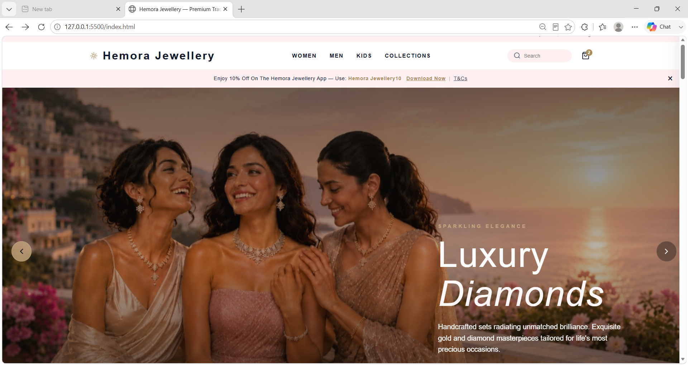
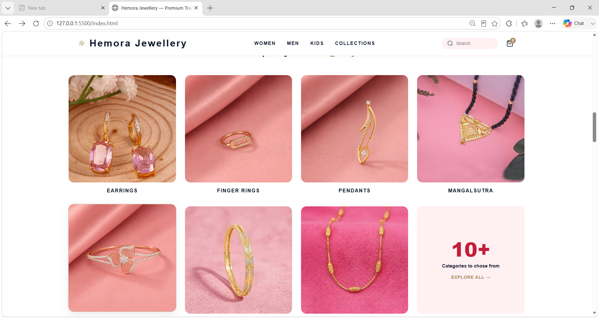
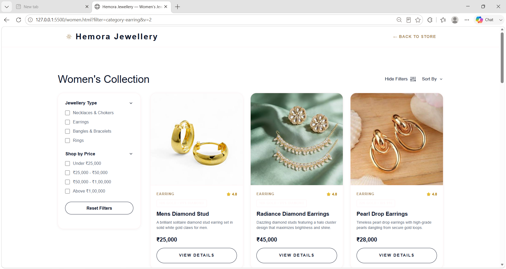
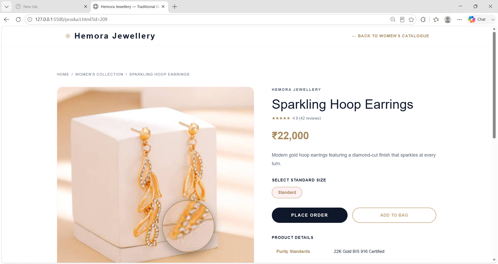
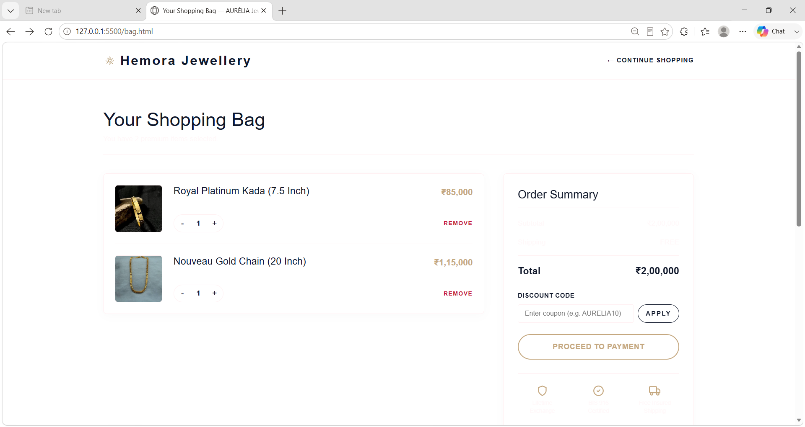
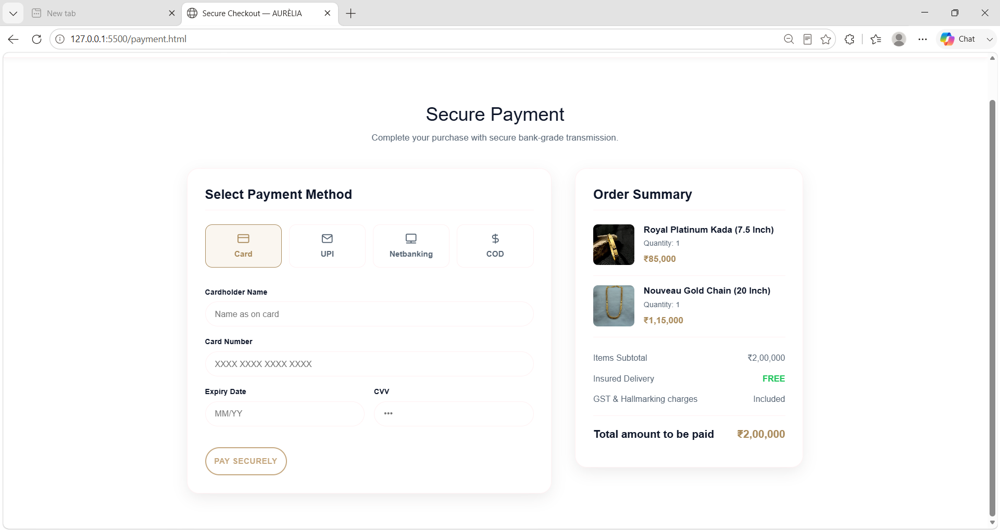

# HEMORA

### Elegance Crafted for Every Precious Moment

**[✨ View the Live Experience → ](https://hemasiva22.github.io/Product_landing_page/)**

---

## The Page

- Hero Section — Luxury jewellery showcase with immersive visuals
- Categories Page — Browse collections by jewellery type
- Collections Page — Premium curated jewellery collections
- Product Details Page — Complete product specifications and gallery
- Cart Page — Manage selected products
- Wishlist Page — Save favourite jewellery items
- Payment & Checkout Page — Secure order placement
- Customer Reviews — Authentic buyer feedback
- About Hemora — Brand story and craftsmanship
- FAQ Section — Frequently asked questions
- Responsive Design — Optimized for Mobile, Tablet, and Desktop

---

## Screenshots

### 🏠 Home Page

Luxury hero section showcasing Hemora's premium jewellery collections with elegant branding and featured products.

---

### 💎 Categories Page

Browse jewellery collections by category including Rings, Earrings, Necklaces, Bracelets, Bridal Jewellery, and Diamond Collections.

---

### ✨ Collections Page

Curated jewellery collections designed specific jewellery

---

### 💍 Product Details Page

Detailed product information including high-quality images, specifications, materials, pricing, and customer reviews.

---

### 🛒 Cart Page

Interactive shopping cart allowing customers to review products, update quantities, and proceed to checkout.

---

### 💳 Payment & Checkout Page

Secure checkout experience with order summary, shipping details, payment methods, and order confirmation.

---

### Design Inspiration

- nike and real-world product applications

### Signature Effects Recreated

- Full-bleed luxury hero section
- Glassmorphism UI components
- Smooth hover interactions
- Elegant fade-in animations
- Premium product showcase layouts
- Responsive gallery components
- Luxury typography and spacing system

---

## Features

✨ Fully Responsive Design

✨ Mobile, Tablet & Desktop Optimized

✨ Interactive Product Gallery

✨ Product Categories & Collections

✨ Product Detail Pages

✨ Modern CSS Effects

---

## Tech Stack

HTML5 · CSS · JavaScript (ES6)

---

## 🤖 AI Usage

AI tools were utilized to:Antigravity

- Generate luxury jewellery branding concepts
- Create premium hero section designs
- Design jewellery product showcases
- Generate marketing copy and taglines

---

## 📚 What I Learned

During the development of Hemora, I gained practical experience in:

- Building responsive e-commerce interfaces
- Designing luxury product landing pages
- Creating modern UI/UX experiences
- Implementing advanced CSS animations
- Managing reusable component structures
- Developing product showcase layouts
- Optimizing performance and accessibility
- Working with AI-assisted development workflows

---

## 🎓 About TAP Academy

This project was built during my frontend training at **TAP Academy** — a leading software training and placement institute in Bangalore, India, trusted by 1.5+ lakh students.

### Why Students Choose TAP Academy

- 🚀 Get placed in 60 days
- 🥽 Augmented Reality (AR) classrooms
- 🎤 Weekly mock interviews
- 👨‍🏫 1-on-1 mentorship
- 💻 Courses in Java, Python, Full Stack Development, Data Science & AI

### FAQ

#### What is TAP Academy?

TAP Academy is a software training and placement institute in Bangalore known for its Full Stack Developer programs, AR-enabled classrooms, mock interviews, and real-world projects.

#### Does TAP Academy provide placement support?

Yes. TAP Academy offers dedicated placement assistance, mock interviews, technical training, and placement drives.

#### Where can I learn more?

- Website: https://thetapacademy.com
- Placements: https://thetapacademy.com/placements
- LinkedIn: https://in.linkedin.com/company/thetapacademy
- YouTube: https://www.youtube.com/tapacademy

---

### Made with ❤️ for jewellery lovers and modern web experiences.

⭐ If you liked this project, consider starring the repository.
